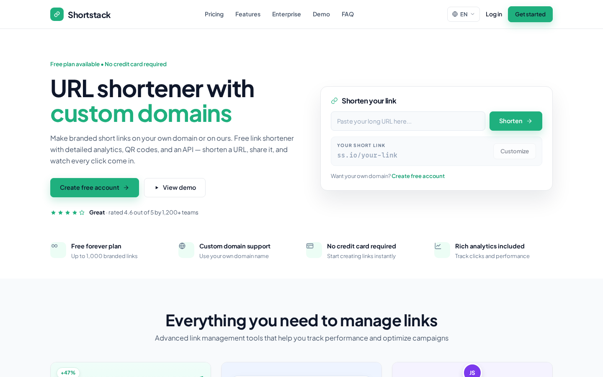
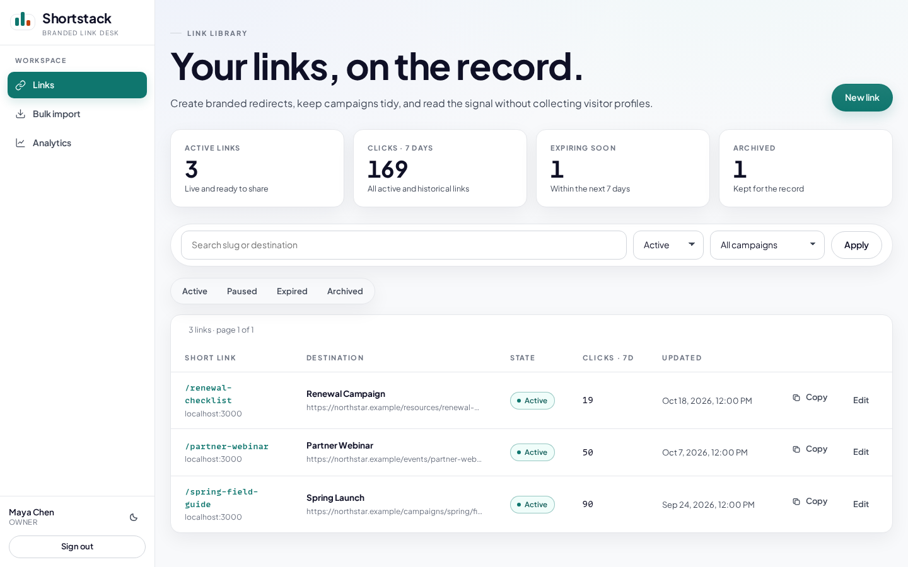
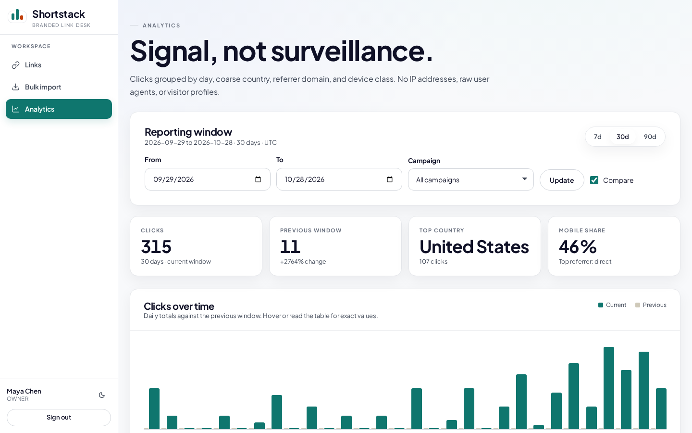
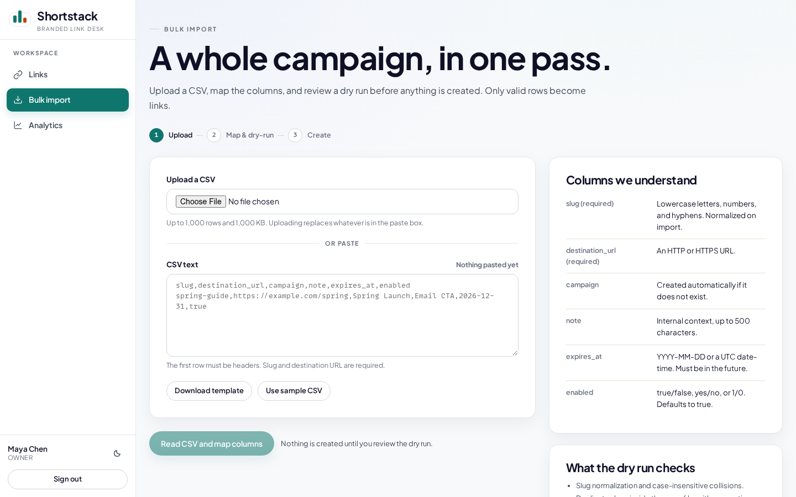

<p align="center">
  
</p>

<p align="center">
  <strong>A self-hosted link management platform for marketing teams.</strong>
</p>

<p align="center">
  <a href="https://github.com/rubiin/shortstack/actions/workflows/ci.yml"></a>
  <a href="https://nodejs.org/"></a>
  <a href="https://react.dev/"></a>
  <a href="https://vite.dev/"></a>
  <a href="https://www.sqlite.org/"></a>
  <a href="https://vitest.dev/"></a>
  <a href="LICENSE"></a>
</p>

<p align="center">
  Branded short links, QR codes, privacy-minimized analytics, and CSV bulk import — built on TanStack Start, SQLite, and a background job worker.
</p>

## Screenshots

| Landing page | Link desk |
| --- | --- |
|  |  |

| Analytics | Bulk import |
| --- | --- |
|  |  |

## Features

- **Branded short links** — custom slugs, link states (active, paused, expired, archived), folders, tags, search, and campaign tracking.
- **QR codes** — generated per link with editable destinations, exported as PNG, SVG, and PDF, including bulk ZIP downloads from imports.
- **Privacy-minimized analytics** — reports store link, day, coarse country, referrer domain, and device class only. IP addresses, raw user agents, query secrets, and exact timestamps are discarded at ingestion.
- **CSV bulk import** — dry-run validation, duplicate and invalid-row resolution, background link creation, and retention-based cleanup of raw uploads.
- **Custom domains** — domains are workspace resources; links are served over HTTPS through the configured short-link origin.
- **Team workspaces** — owner and member roles with authorization enforced server-side on every mutation.
- **Exports** — analytics and link exports generated by a background worker and downloaded through signed, expiring URLs.
- **Cloudflare cache purging** — optional adapter that purges cached URLs after link changes (redirects are `no-store`, so purge is a safety net, not a correctness requirement).

## Tech stack

| Layer      | Choice                                       |
| ---------- | -------------------------------------------- |
| Framework  | TanStack Start + TanStack React Router       |
| UI         | React 19, Vite                               |
| Database   | SQLite (better-sqlite3) with SQL migrations  |
| Validation | Zod                                          |
| Tests      | Vitest (unit + integration), Playwright (E2E) |
| Runtime    | Node.js ≥ 22.12                              |

## Getting started

```sh
cp .env.example .env
# edit .env and set SESSION_SECRET and FILE_SIGNING_SECRET (32+ random chars)
npm install
npm run db:setup
npm run dev
```

The app runs at http://localhost:3000 with a web process and a job worker. Seeded demo accounts (password is the value of `SEED_PASSWORD`, default `shortstack-demo`):

| Role   | Email                     |
| ------ | ------------------------- |
| Owner  | `maya@northstar.example`  |
| Member | `theo@northstar.example`  |

## Configuration

All settings live in `.env`; see `.env.example` for the full list with defaults.

| Variable                    | Purpose                                                      |
| --------------------------- | ------------------------------------------------------------ |
| `APP_ORIGIN`                | Canonical application URL.                                   |
| `SHORT_LINK_ORIGIN`         | Host used for generated short links.                         |
| `SESSION_SECRET`            | Session token hashing. 32+ random characters in production.  |
| `FILE_SIGNING_SECRET`       | Signs download URLs for exports and QR archives.             |
| `DATABASE_PATH`             | SQLite database location.                                    |
| `FILE_STORAGE_DIR`          | Uploaded and generated file storage.                         |
| `EXPORT_RETENTION_DAYS`     | Lifetime of generated export files.                          |
| `RAW_IMPORT_RETENTION_DAYS` | Lifetime of raw CSV text and raw import JSON.                |
| `CLICK_RETENTION_MONTHS`    | Lifetime of stored click events.                             |
| `CLOUDFLARE_PURGE_ENABLED`  | Enables the Cloudflare purge adapter (off by default).       |
| `WORKER_POLL_MS`            | Background worker poll interval.                             |

## Commands

| Command             | Description                                   |
| ------------------- | --------------------------------------------- |
| `npm run dev`       | Web server and worker in watch mode.          |
| `npm run build`     | Production build into `.output/`.              |
| `npm start`         | Run the built server.                         |
| `npm run worker`    | Run the background worker standalone.         |
| `npm run db:migrate`| Apply SQL migrations.                         |
| `npm run db:seed`   | Seed demo workspace and data.                 |
| `npm run db:reset`  | Drop and recreate local data.                 |
| `npm run db:setup`  | Migrate, then seed.                           |

## Testing

```sh
npm run typecheck   # TypeScript, no emit
npm run test        # unit + integration (Vitest)
npm run test:e2e    # browser journeys (Playwright)
npm run build       # production build
npm run check       # typecheck + test + build
```

Playwright starts its own server on port 3100 with an isolated test database (`data/e2e.db`), so E2E runs do not touch local data.

## Architecture

```
src/
  domain/    # pure domain logic: slugs, CSV, imports, authz, privacy
  routes/    # TanStack Start routes: landing, auth, app pages, API handlers
  components/# shared UI and app-shell components
  server/    # db, auth, links, redirects, analytics, jobs, adapters
  server/functions/  # server functions invoked from routes
db/migrations/       # numbered SQL migrations (run automatically on open)
scripts/             # migrate, seed, reset
tests/               # unit, integration, and Playwright E2E suites
```

Migrations run automatically when the database opens; the explicit commands above exist for CI and operations.

## Deployment

1. Build: `npm run build`.
2. Copy `.output/`, `data/`, `storage/`, and `.env` to the server.
3. Set production secrets and origins in `.env`.
4. Run migrations: `npm run db:migrate`.
5. Start the app: `npm start`.
6. Run the worker as a separate process: `npm run worker`.

The app and worker share `DATABASE_PATH` and `FILE_STORAGE_DIR`.

### Backup and restore

Back up `DATABASE_PATH` together with its `-wal` and `-shm` files while the app is stopped, and back up `FILE_STORAGE_DIR`. Restore both at the same time.

## Security and privacy

- Only HTTP/HTTPS destinations are accepted; credentials and control characters are rejected.
- Destination URLs are never fetched during redirect.
- Analytics store only link, day, coarse country, referrer domain, and device class.
- Sessions use opaque hashed tokens; passwords are hashed with scrypt.
- CSRF protection and rate limits apply to authentication and mutating requests.
- Export and archive downloads require signed, expiring URLs.

## Limitations

- Single-workspace tenant model.
- No ad retargeting, deep links, link-in-bio pages, or enterprise permission tiers.
- Cloudflare and custom-domain integrations are adapter-based with local fakes; live services require credentials.
- SQLite is the persistence layer — scale horizontally with care.
